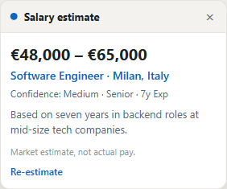
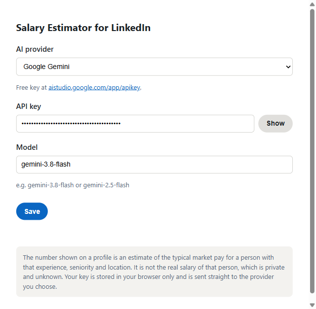

  

# Salary Estimator for LinkedIn

A Chrome extension that shows an estimated market salary range for a LinkedIn profile. It reads the whole
profile (years of experience, the roles and how they progressed, seniority, education, skills and location)
and asks an AI for the typical pay for someone with that background. A small card appears in the bottom right
of the page.

The number is a market estimate for a person with that experience, not the real salary of that individual.
A person's actual pay is private and unknown. Think of it like a quick Glassdoor lookup.

  

The card on a profile (example data).

## What you need
A free API key from one of these providers, set in the options:

- **Google Gemini** - [aistudio.google.com/app/apikey](https://aistudio.google.com/app/apikey)
- **Groq** - [console.groq.com/keys](https://console.groq.com/keys)
- **OpenRouter** - [openrouter.ai/keys](https://openrouter.ai/keys) (pick a model ending in `:free`)

The key stays in your browser and is sent straight to the provider you pick. You can switch provider any time.

## Install
1. Download or clone this folder.
2. Open `chrome://extensions` and turn on Developer mode (top right).
3. Click Load unpacked and select the folder.
4. Click the extension icon, open Options, choose a provider and paste its API key. Click "Load models" to
   see the models your key can use and pick one.

  

## Use
Open any profile at `linkedin.com/in/…`. A card shows in the bottom right with an "Estimate market salary"
button. Click it to get a range for that background, the location it used, and a confidence level. Estimates are
cached per profile for a month so you do not spend quota reopening the same page.

## How it works
- The content script reads the public text of the profile: headline, location, the full experience,
  education and skills. The name is left out, since a market estimate does not need it.
- The background worker sends it to your chosen provider (Gemini natively, Groq and OpenRouter through their
  OpenAI-compatible API) and gets back a currency, a min and a max, years of experience and a confidence level.
- Your API key lives in `chrome.storage` and is only used by the background worker, never exposed to the page.

## Notes
- This is a rough estimate from a language model. Treat it as a ballpark, not a fact.
- LinkedIn changes its page structure now and then. If the card stops reading the profile, the selectors to
  update are in `content/content.js` (`readProfileText`).
